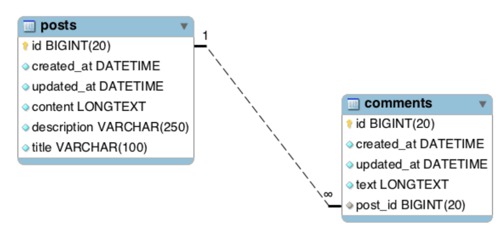
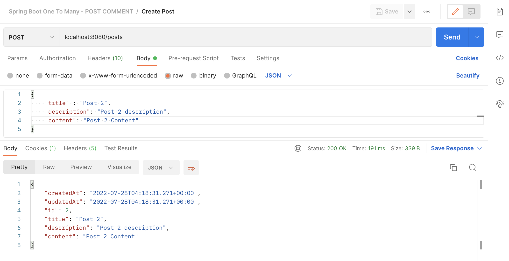
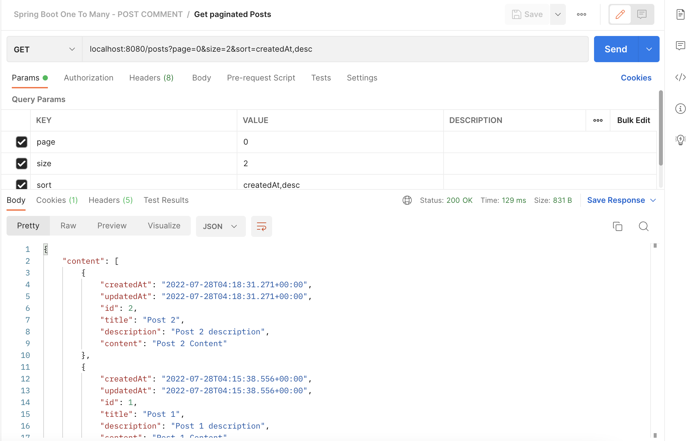
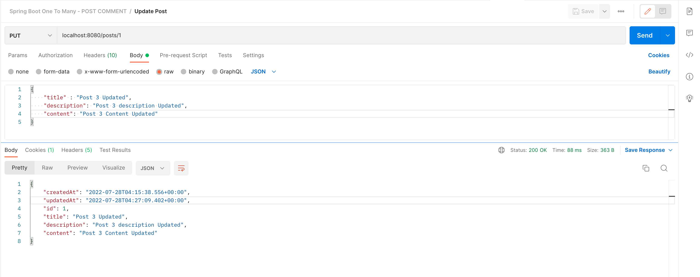
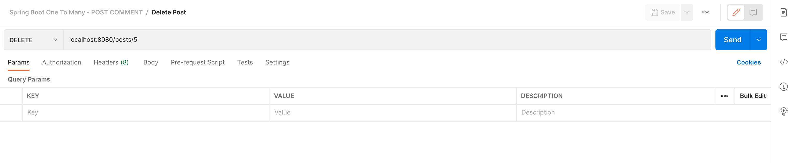
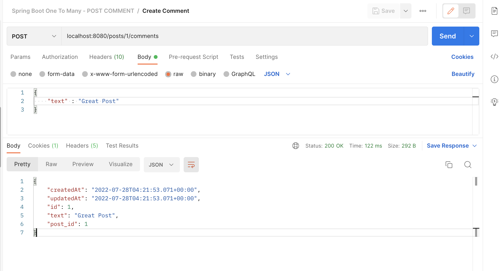
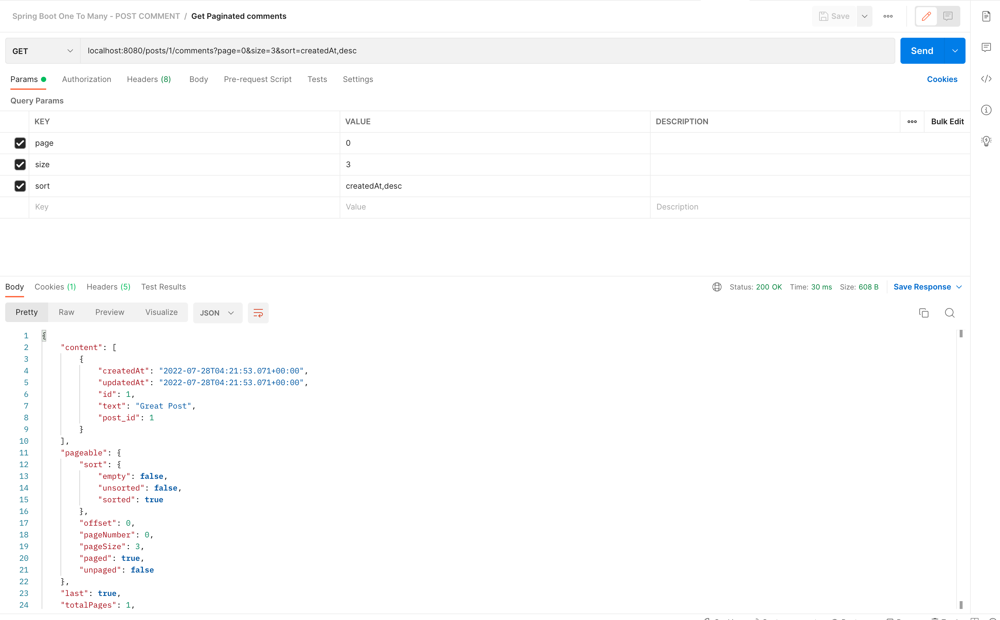
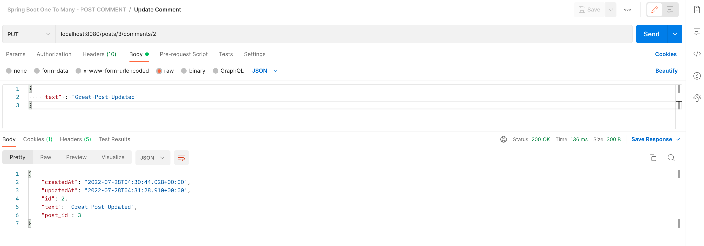
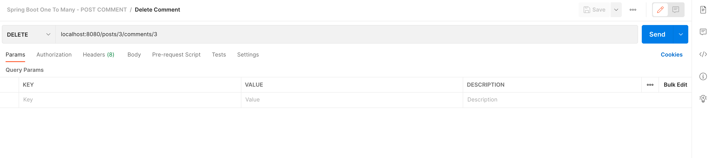

# Spring Boot One To Many

[](https://github.com/hendisantika/spring-boot-one-to-many/actions/workflows/maven.yml)


Sample REST API that demonstrates a JPA **one-to-many** relationship (`Post` 1 ➜ N `Comment`) using Spring Boot,
Spring Data JPA, Hibernate and MySQL.

## Tech Stack

| Component        | Version                                |
|------------------|----------------------------------------|
| Java (JDK)       | 25 (Temurin)                           |
| Spring Boot      | 4.1.1                                  |
| Hibernate ORM    | 7.x (managed by Spring Boot)           |
| MySQL            | 9.1.0 (via Docker Compose)             |
| Testcontainers   | 2.x (managed by Spring Boot)           |
| Build tool       | Maven (wrapper included)               |
| Others           | Lombok, Bean Validation, DevTools      |

## Prerequisites

- JDK **25**
- Docker (used by Spring Boot Docker Compose support at runtime and by Testcontainers in tests)
- Maven 3.6.3+ (or use the bundled `./mvnw`)

## Things todo list

1. Clone this repository: `git clone https://github.com/hendisantika/spring-boot-one-to-many.git`
2. Navigate to the folder: `cd spring-boot-one-to-many`
3. Run application: `./mvnw clean spring-boot:run`
    - `spring-boot-docker-compose` will automatically start the MySQL container defined in [`compose.yml`](compose.yml).
    - Want to use your own MySQL instead? Change the credentials in `src/main/resources/application.properties`.
4. Open Postman App and import the Postman collection file
   [`Spring Boot One To Many - POST COMMENT.postman_collection.json`](Spring%20Boot%20One%20To%20Many%20-%20POST%20COMMENT.postman_collection.json)

## Running Tests

```shell
./mvnw clean verify
```

Integration tests spin up a throw-away MySQL container through Testcontainers
(`jdbc:tc:mysql:9.1.0:///one2Many`), so Docker must be running.

## CI/CD & Dependency Management

- **GitHub Actions** — [`.github/workflows/maven.yml`](.github/workflows/maven.yml) builds and tests the project on
  JDK 25 for every push / pull request to `main` and submits the Maven dependency graph to GitHub on `main`.
- **Dependabot** — [`.github/dependabot.yml`](.github/dependabot.yml) keeps these up to date:
    - Maven dependencies (daily, grouped: Spring Boot, Testcontainers, Jackson, Maven plugins, other minor/patch)
    - GitHub Actions (daily, grouped into one PR)
    - Docker Compose images (weekly)

## API Endpoints

| Method | Endpoint                               | Description                  |
|--------|----------------------------------------|------------------------------|
| GET    | `/posts`                               | List posts (pageable)        |
| POST   | `/posts`                               | Create a post                |
| PUT    | `/posts/{postId}`                      | Update a post                |
| DELETE | `/posts/{postId}`                      | Delete a post                |
| GET    | `/posts/{postId}/comments`             | List comments of a post      |
| POST   | `/posts/{postId}/comments`             | Add a comment to a post      |
| PUT    | `/posts/{postId}/comments/{commentId}` | Update a comment             |
| DELETE | `/posts/{postId}/comments/{commentId}` | Delete a comment             |

## Image Screen shots

Diagram



Add Post



```shell
curl --location --request POST 'localhost:8080/posts' \
--header 'Content-Type: application/json' \
--data-raw '{
    "title" : "Post 4",
    "description": "Post 4 description",
    "content": "Post 4 Content"
}'
```

List Posts



```shell
curl --location --request GET 'localhost:8080/posts?page=0&size=2&sort=createdAt,desc'
```

Update Post



```shell
curl --location --request PUT 'localhost:8080/posts/3' \
--header 'Content-Type: application/json' \
--data-raw '{
    "title" : "Post 3 Updated",
    "description": "Post 3 description updated",
    "content": "Post 3 Content updated"
}'
```

Delete Post



```shell
curl --location --request DELETE 'localhost:8080/posts/5'
```

Add Comment



```shell
curl --location --request POST 'localhost:8080/posts/3/comments' \
--header 'Content-Type: application/json' \
--data-raw '{
    "text" : "Great Post"
}'
```

List Comments



```shell
curl --location --request GET 'localhost:8080/posts/3/comments?page=0&size=3&sort=createdAt,desc'
```

Update Comment



```shell
curl --location --request PUT 'localhost:8080/posts/3/comments/2' \
--header 'Content-Type: application/json' \
--data-raw '{
    "text" : "Great Post Updated"
}'
```

Delete Comment



```shell
curl --location --request DELETE 'localhost:8080/posts/3/comments/3'
```
